<!-- ========================= -->
<!--      GITHUB PROFILE      -->
<!-- ========================= -->

  

  

  &nbsp;
  &nbsp;
  

 

  

<table align="center">
  <tr>
    <td>
      🔭 &nbsp; I am currently working on <b>AI-powered real-world applications</b> and <b>Full-Stack projects</b>. 
      🤝 &nbsp; I am looking to collaborate on <b>AI/ML, Open Source</b>, and <b>Innovative Software Projects</b>. 
      🛠️ &nbsp; I am looking for help with <b>System Design, MLOps</b>, and <b>Scalable AI Solutions</b>. 
      📚 &nbsp; I am currently learning <b>Advanced AI/ML, Deep Learning, LLMs</b>, and <b>Cloud Technologies</b>. 
      💬 &nbsp; Ask me about <b>Python, AI/ML, Computer Vision, Full-Stack Development</b>, and <b>Hackathons</b>. 
      ✨ &nbsp; Fun fact: <i>I love turning crazy ideas into real working products.</i>
    </td>
  </tr>
</table>

 

  

  

  

  

  

 

  

<h3 align="center">Languages</h3>

  
  
  
  
   
  
  
  

<h3 align="center">AI, Deep Learning &amp; Computer Vision</h3>

  
  
  
  
   
  
  
  
  
  

<h3 align="center">RAG, Search &amp; Geospatial</h3>

  
  
  
  

<h3 align="center">Frameworks &amp; Full-Stack</h3>

  
  
  
   
  
  
  

<h3 align="center">Databases &amp; Cloud</h3>

  
  
  
  
   
  
  
  
  

<h3 align="center">Tools &amp; Environment</h3>

  
  
  
  
  

 

  

  
  &nbsp;&nbsp;
  
    
  

 

  

  

  

 

<!-- UNIFIED FOOTER: Always-Working High-End Views Counter -->

  

    <i>"First, solve the problem. Then, write the code."</i> 
    <b>— John Johnson</b>
  

  

    
  

  

    <i>"See you in the next commit."</i> 
    Built with ❤️, curiosity, and countless cups of coffee.
  

